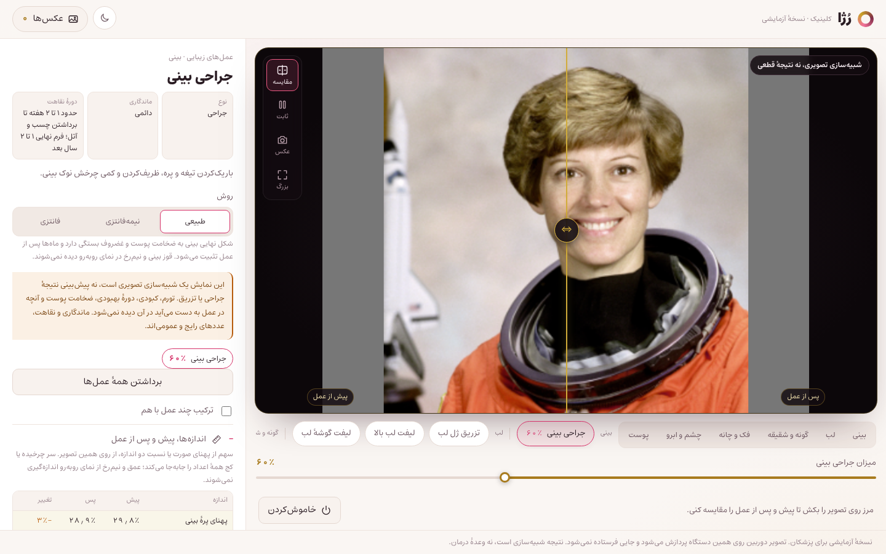
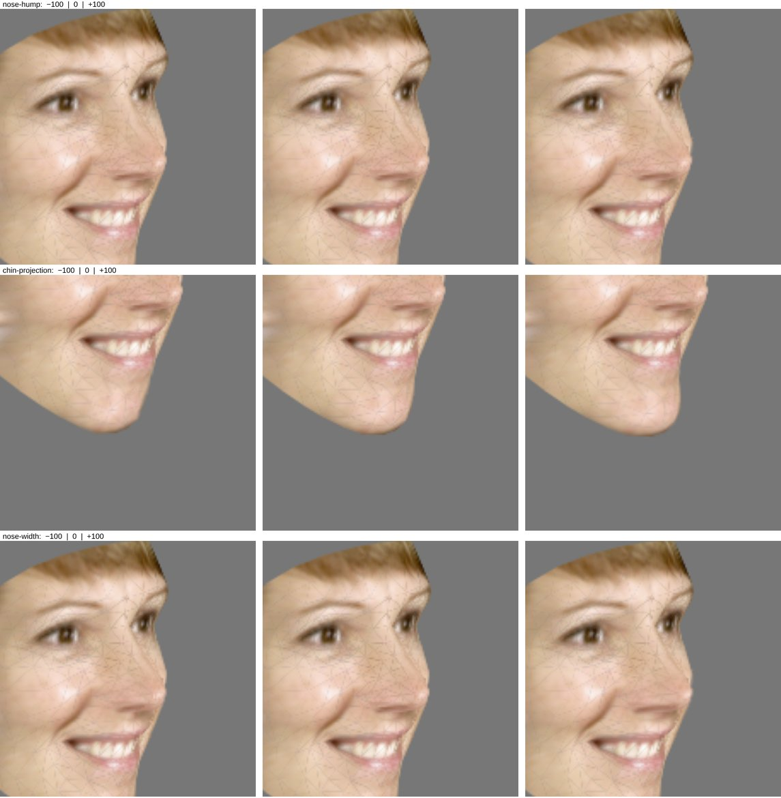

# رُژا کلینیک · Roja Clinic

پیش‌نمایش زندهٔ عمل‌های زیبایی برای مطب و کلینیک: پزشک یک عمل را انتخاب می‌کند و نتیجهٔ
تقریبی آن همان لحظه روی تصویر زندهٔ صورت بیمار ساخته می‌شود، با مرز «پیش / پس از عمل»،
جدول اندازه‌ها و عکس برای مقایسه. همه‌چیز داخل مرورگر و روی همان دستگاه اجرا می‌شود؛
تصویر دوربین هیچ‌جا فرستاده یا ذخیره نمی‌شود.

> A live, on-device preview of cosmetic procedures for aesthetic clinics. Split out of
> [Roja](https://github.com/soroushaz1/roja)'s procedure mode to be developed on its own,
> towards a beta for a handful of doctors.



این مخزن از بخش «عمل‌های زیبایی» سایت رُژا جدا شده و از این به بعد جداگانه توسعه پیدا می‌کند.
آرایش، فروشگاه‌ها، تحلیل پوست و اپ اندروید در رُژا مانده‌اند و اینجا نیستند.

---

## این ابزار پزشکی نیست

نمایش، یک **شبیه‌سازی تصویری از تغییر شکل** است، نه پیش‌بینی نتیجه. تورم، کبودی، بهبود،
اسکار، ضخامت پوست و آنچه هر جراح در عمل به دست می‌آورد در آن مدل نشده است. ماندگاری و دورهٔ
نقاهت، بازه‌های رایج و عمومی‌اند. هر عکسی که ذخیره می‌شود این را روی خودش دارد.

## چه چیزی در آن هست

- **۱۷ عمل** در شش ناحیه: بینی، لب، گونه و شقیقه، فک و چانه، چشم و ابرو، پوست. بعضی‌ها چند
  روش دارند (مثلاً جراحی بینی طبیعی / نیمه‌فانتزی / فانتزی، یا فک با بوتاکس / جراحی).
- **مدل‌های آماده لب**: طبیعی، روسی، M شکل، فرانسوی، قلبی، ونوس و پرحجم؛ هم به‌صورت روش‌های
  «تزریق ژل لب» و هم با یک کلیک در «تنظیم دقیق» که اسلایدرهای لب را تنظیم می‌کند و بعد می‌شود
  دستی تغییرشان داد (`lipStyles` در `procedures.js`). معنای این نام‌ها در هر مطب کمی فرق دارد.
- **سه‌بعدی**: هر تغییر روی مدل سه‌بعدی صورت ساخته می‌شود، پس از روبه‌رو، سه‌رخ و تا حدود ۵۰
  درجه چرخش درست دیده می‌شود، و تغییرهای عمقی (قوز بینی، جلوآمدگی نوک بینی و چانه) با
  چرخاندن سر پیدا می‌شوند. نگاه کنید به «سه‌بعدی چطور کار می‌کند».
- **۳۵ کنترل ناحیه‌ای** (۴ تا در عمق) برای تنظیم دقیق، روی نتیجهٔ عمل‌ها یا بدون هیچ عملی؛
  از جمله نوک بینی به چپ و راست و کجی تیغهٔ بینی برای بینی کج.
- **مرز پیش و پس** که روی تصویر کشیده می‌شود (دکمهٔ «مقایسه» آن را برمی‌دارد تا کل نتیجه دیده شود).
- **جدول اندازه‌ها**: ۱۹ اندازه و نسبت (پهنای پرهٔ بینی، قوز تیغه، جلوآمدگی نوک بینی و چانه،
  ضخامت لب‌ها، زاویهٔ گوشهٔ چشم، پهنای فک، یک‌سوم‌های صورت و…)، پیش و پس، روی مدل سه‌بعدی و
  به‌صورت سهمی از پهنای صورت، تا با فاصله از دوربین و چرخش سر کمتر عوض شود.
- **عکس** از نتیجه و مقایسهٔ دو عکس کنار هم؛ **ثابت‌کردن تصویر**؛ **تمام‌صفحه**.
- **عکس به‌جای دوربین**: یک عکس روبه‌رو یا سه‌رخ را باز کنید (یا روی تصویر بیندازید).
- **نمایشگر بیمار**: دکمهٔ «نمایشگر بیمار» (یا <kbd>P</kbd>) پنجرهٔ دومی برای مانیتور بیمار
  باز می‌کند که فقط نتیجهٔ زنده را تمام‌صفحه نشان می‌دهد، با مرز پیش و پس، نام عمل و یادداشت
  «شبیه‌سازی»؛ همهٔ کنترل‌ها روی صفحهٔ پزشک می‌مانند و هر تغییری همان لحظه آنجا دیده می‌شود.
  روی کامپیوتر دو مانیتوره، اگر مرورگر اجازه بدهد پنجره خودش به مانیتور دیگر می‌رود؛ وگرنه آن
  را به مانیتور بیمار بکشید و یک بار رویش بزنید (یا <kbd>F</kbd>) تا تمام‌صفحه شود. وقتی
  دوربین خاموش است، صفحهٔ آرامی با نام مطب نشان می‌دهد.
- **پروندهٔ بیمار**: بیمار تازه (نام یا کد پرونده، سن، جنس، یادداشت) یا انتخاب از فهرست؛ تا
  پرونده باز است، هر «عکس» با تصویر پیش و پس، عمل‌ها و اندازه‌های همان لحظه در جلسهٔ امروز
  ذخیره می‌شود. جلسه‌های قبلی، یادداشت پزشک برای هر جلسه، حذف عکس یا بیمار، و پشتیبان‌گیری و
  بازگرداندن همه‌چیز در یک فایل. همه فقط روی همین دستگاه.
- **گزارش PDF** هر جلسه: سربرگ مطب و پزشک با تاریخ شمسی، مشخصات بیمار، عمل‌های بررسی‌شده با
  روش و میزان و ماندگاری و نقاهت، هر جفت پیش و پس روی صورت با جدول اندازه‌هایی که عوض شده‌اند،
  یادداشت پزشک، توضیح «شبیه‌سازی است، نه وعده» و رضایت‌نامه با جای امضای بیمار و پزشک.
- **حالت دیباگ** برای R&D: نقاط صورت با شماره، شبکه، کانتورها، محورها، میدان جابه‌جایی،
  ماسک‌های پوست، آمار زنده و خروجی JSON از نقاط، زاویهٔ سر و اندازه‌ها (بدون تصویر).
- لینک مستقیم به یک عمل: `#procedure=rhinoplasty`.

میان‌برها: <kbd>C</kbd> مقایسه، <kbd>F</kbd> ثابت، <kbd>S</kbd> عکس، <kbd>P</kbd> نمایشگر بیمار.

## اجرا

Node.js لازم است و هیچ وابستگی دیگری نصب نمی‌شود.

**ویندوز:** روی `start-clinic.cmd` دوبار کلیک کنید. سرور روشن می‌شود و برنامه در Chrome (یا
مرورگر پیش‌فرض) باز می‌شود. پنجرهٔ سیاه را باز بگذارید؛ بستنش برنامه را خاموش می‌کند. اگر برنامه
از قبل روشن باشد، فقط مرورگر را باز می‌کند؛ اگر Node.js نصب نباشد، صفحهٔ دانلودش را باز می‌کند.

**هر سیستمی، از ترمینال:**

```sh
node tools/preview.cjs        # http://127.0.0.1:4174
```

بعد نشانی را در Chrome باز کنید. روی `localhost` / `127.0.0.1` مرورگر اجازهٔ دوربین می‌دهد؛
روی شبکه یا اینترنت باید HTTPS باشد. پورت دیگر: `PORT=8080 node tools/preview.cjs`.

پارامترهای نشانی:

| | |
|---|---|
| `?res=480` / `720` / `1080` | وضوح دوربین (پیش‌فرض ۷۲۰p؛ برای دوربین خوب ۱۰۸۰ را امتحان کنید) |
| `?gpu=0` | مدل تشخیص چهره روی CPU (پیش‌فرض: GPU اگر باشد) |
| `?gpu=force` | اصرار بر GPU، برای مقایسه |
| `?sync=always` | همیشه فریم و نقاط هم‌زمان نشان داده شوند |

## تست

```sh
node tools/warp-check.mjs     # هندسهٔ سه‌بعدی، بدون مرورگر
node tools/preview.cjs        # در یک ترمینال
node tools/clinic-check.cjs   # در ترمینال دیگر
```

`warp-check.mjs` صورت استاندارد MediaPipe را با زاویه‌های مشخص می‌چرخاند و بررسی می‌کند:
در صفر چیزی تکان نمی‌خورد؛ تغییر عمقی از روبه‌رو تقریباً دیده نمی‌شود و با چرخش سر به نسبت
سینوس زاویه دیده می‌شود، و تغییر عرضی برعکس؛ تغییر بینی در هیچ زاویه‌ای به گونه نمی‌رسد؛
اندازه‌ها با چرخش سر ثابت می‌مانند و تغییرها را نشان می‌دهند؛ و پس‌زمینه دنبال لبهٔ صورت
می‌آید و دور از صورت ثابت می‌ماند.

`clinic-check.cjs` با یک دوربین ساختگی (عکس `tools/face-test.png`) همه‌چیز را در Chromium
امتحان می‌کند: هر عمل فقط بخشی از صورت را تغییر می‌دهد و درست برمی‌گردد، روش‌ها، مرز،
کنترل‌ها، اندازه‌ها، دیباگ و خروجی، عکس، باز کردن عکس و لینک مستقیم؛ و روی یک صورت چرخیده
(`tools/face-turned.png`) که تغییر قوز و چانه دیده می‌شود، اندازه‌ها آن را نشان می‌دهند و هیچ
پیکسلی دور از صورت عوض نمی‌شود؛ و پروندهٔ بیمار: ساختن بیمار، ذخیرهٔ عکس‌ها در جلسه، گزارش
PDF درست (با `pdfinfo` اگر نصب باشد) که با برداشتن یک عکس کوتاه‌تر می‌شود، ماندن همه‌چیز پس از
بارگذاری دوباره، و پشتیبان، حذف و بازگرداندن؛ و نمایشگر بیمار: همان تصویر صفحهٔ پزشک، نام عمل،
مرزی که با مرز پزشک جابه‌جا می‌شود، صفحهٔ آرام پس از خاموش‌شدن دوربین، و باز و بسته‌شدن با <kbd>P</kbd>. Playwright لازم است (`npm i -g playwright`).

`tools/face-turned.png` را `tools/make-turned-face.cjs` می‌سازد: نقاط سه‌بعدی همان عکس روبه‌رو
را ۵۰ درجه می‌چرخاند و بافت عکس را دوباره روی شبکهٔ چرخیده می‌کشد (ردیاب آن را حدود ۳۳ درجه
می‌خواند).

## سه‌بعدی چطور کار می‌کند

1. **مدل صورت**: MediaPipe برای هر کدام از ۴۷۸ نقطه، جای آن در تصویر و عمقش را می‌دهد
   (`points3` در `deform.js`). از روی چند نقطه، دستگاه مختصات خود سر ساخته می‌شود: در عرض صورت،
   رو به پایین، و رو به جلو از صورت (`headFrame`).
2. **تغییر شکل**: هر کنترل چند «تغییردهنده» است که روی نقطه‌ها لنگر می‌اندازند و جهت و شعاعشان
   در دستگاه سر تعریف شده؛ پس با سر می‌چرخند. فاصله تا لنگر سه‌بعدی اندازه گرفته می‌شود (عمق با
   وزن نصف)، پس در نیم‌رخ تغییر بینی به گونهٔ پشت آن نمی‌رسد. خروجی، جابه‌جایی سه‌بعدی هر نقطه است.
   **قوز بینی** اول پیدا می‌شود (`hump` در `deform.js`): برای هر نقطهٔ تیغه (۱۶۸ تا ۴) اندازه
   گرفته می‌شود که چقدر از خط صاف ریشه تا نوک بیرون زده، و این با همان روی صورت میانگین MediaPipe
   مقایسه می‌شود، چون هر تیغه‌ای نزدیک نوک کمی انحنا دارد که قوز نیست. جایی که بیشترین بیرون‌زدگی
   را دارد قلهٔ قوز است، و اسلایدر همان‌جا را به اندازهٔ همان بیرون‌زدگی پایین می‌آورد (دست‌کم ۲٪
   پهنای صورت). «جای قوز» آن را روی تیغه بالا و پایین می‌برد، و اندازهٔ «قوز تیغهٔ بینی» در جدول
   همین عدد است: صفر یعنی تیغه‌ای مثل میانگین.
3. **رساندن به تصویر** (`warp.js` و `stage.js`): جابه‌جایی‌ها روی تصویر نگاشته می‌شوند؛ خود
   شبکهٔ صورت (۸۹۸ مثلث، با چشم و دهان) با تست عمق کشیده می‌شود تا جلویی‌ها پشتی‌ها را بپوشانند،
   و زیرش یک شبکهٔ پس‌زمینه با میدانی نرم که از نقاط دیده‌شدهٔ صورت پخش شده، تا وقتی لبهٔ صورت
   جابه‌جا می‌شود لبهٔ قدیمی پیدا نماند.
4. **جایی که دوربین ندیده**: وقتی سر می‌چرخد، بینی بخشی از گونهٔ دور را می‌پوشاند و در تصویر
   به جای آن گونه، لبهٔ خود بینی هست. اگر عمل آن بخش را باز کند (بینی باریک‌تر، قوز برداشته)،
   برداشتن بافت از همان‌جا لبهٔ بینی قبلی را دوباره نشان می‌داد. برای همین هر فریم عمق صورت همان‌طور
   که دوربین دیده کشیده می‌شود، و نقطه‌ای که پنهان بوده رنگش را از پوست دیده‌شدهٔ اطرافش با همان
   عمق می‌گیرد (`WARP_FRAG` در `shaders.js`).



محدودیت‌ها: عمق را مدل از تصویر یک دوربین **تخمین** می‌زند، اندازه نمی‌گیرد؛ پس اندازه‌های عمقی
برای مقایسهٔ پیش و پس روی یک صورت‌اند، نه میلی‌متر. چیزی که پشت صورت پنهان است (گوش دور، پشت
بینی در نیم‌رخ کامل) در تصویر نیست که ساخته شود، و ردیاب از حدود ۵۰ درجه به بعد دقتش کم می‌شود.
مو، گوش و گردن جزو شبکه نیستند و فقط با میدان پس‌زمینه کمی جابه‌جا می‌شوند.

## ساختار

| فایل | کار |
|---|---|
| `index.html`, `clinic.css` | صفحه و ظاهر (روشن و تیره) |
| `app.js` | منطق برنامه: دوربین و عکس، ردیابی، انتخاب عمل‌ها، مرز، اندازه‌ها، عکس، دیباگ |
| `procedures.js` | فهرست عمل‌ها، هرکدام وزن‌هایی روی کنترل‌های ناحیه‌ای، با روش‌ها و توضیحات |
| `deform.js` | کنترل‌های ناحیه‌ای، دستگاه مختصات سر و جابه‌جایی سه‌بعدی هر نقطه |
| `warp.js` | رساندن جابه‌جایی‌ها به تصویر: شبکهٔ صورت با عمق، و میدان پس‌زمینه |
| `masks.js` | ماسک ناحیه‌های پوست برای درمان‌های غیرجراحی، و نرم‌کنندهٔ نقاط |
| `measure.js` | اندازه‌ها (سه‌بعدی)، تقارن و زاویهٔ سر |
| `stage.js`, `shaders.js` | رندر WebGL: فریم دوربین روی GPU، لایه‌های پوست، شبکه‌های جابه‌جایی |
| `face-worker.js`, `face-core.js` | تشخیص چهره (MediaPipe) در worker، یا روی صفحه اگر worker نشد |
| `facemesh.js` | شبکهٔ استاندارد صورت MediaPipe (ساختهٔ `tools/facemesh.cjs`) |
| `records.js` | پروندهٔ بیمار روی صفحه: فهرست و فرم بیمار، جلسه‌ها، عکس‌ها، یادداشت، گزارش، پشتیبان |
| `store.js` | پرونده در IndexedDB: بیماران، جلسه‌ها، عکس‌ها؛ پشتیبان و بازگرداندن |
| `report.js` | صفحه‌های A4 گزارش، کشیده روی canvas |
| `pdf.js` | ساختن PDF از تصویر صفحه‌ها، بدون کتابخانه |
| `presenter.js` | نمایشگر بیمار از سمت پزشک: باز و بسته‌کردن پنجره، فرستادن تصویر و وضعیت |
| `present.html`, `present-page.js` | صفحهٔ نمایشگر بیمار |
| `debug.js` | لایه‌های دیباگ |
| `vendor/` | MediaPipe Tasks Vision و مدل صورت، محلی، بدون CDN |
| `start-clinic.cmd` | اجرای برنامه روی ویندوز با دوبار کلیک |

---

## برنامهٔ R&D تا نسخهٔ بتا

### ۱. ایستگاه تصویربرداری

نتیجه و اندازه‌ها فقط به اندازهٔ تصویر خوب‌اند. یک ایستگاه ثابت که هر بار یکسان باشد، از
هر بهبود نرم‌افزاری مهم‌تر است.

- **دوربین**: وب‌کم ۱۰۸۰p یا ۴K که بشود نوردهی، فوکوس و تعادل سفیدی را **قفل** کرد (مثل
  وب‌کم‌های رده‌بالای USB)، یا برای بهترین کیفیت یک دوربین بدون آینه با کارت کپچر HDMI.
  لنز واید زاویه‌باز صورت را کج می‌کند؛ از فاصلهٔ حدود ۶۰ تا ۸۰ سانتی‌متر و هم‌ارتفاع چشم بگیرید.
  وضوح را با `?res=1080` باز کنید.
- **نور**: دو پنل یا سافت‌باکس LED در دو طرف با زاویهٔ حدود ۴۵ درجه (یا یک رینگ‌لایت بزرگ)،
  دمای رنگ ۵۰۰۰ تا ۵۶۰۰ کلوین و CRI بالای ۹۵. نور نرم و یکنواخت، بدون سایهٔ تند، و همیشه
  همان تنظیم، تا عکس‌های پیش و پس قابل مقایسه باشند. نور سقفی تنها، زیر چشم و بینی سایه می‌اندازد.
- **صفحه‌نمایش و رایانه**: مانیتور IPS حدود ۲۴ تا ۳۲ اینچ (یا عمودی، که صورت بزرگ‌تر دیده شود)
  و یک لپ‌تاپ یا مینی‌پی‌سی با گرافیک معقول و Chrome. پنل ابزار برای پزشک و تصویر برای بیمار.
- **پس‌زمینه**: خاکستری یا رنگ خنثی و ثابت.
- **راهنمای جای ایستادن**: علامت روی زمین یا صندلی ثابت، تا فاصله و زاویه هر بار یکی باشد.

### ۲. دقت و واقع‌گرایی

- تنظیم وزن‌ها و شعاع‌های هر عمل در `procedures.js` و `deform.js` همراه با پزشک‌ها، روی چند
  صورت واقعی (با رضایت)، و مقایسه با عکس‌های واقعی پیش و پس.
- **نیم‌رخ**: تغییرها حالا سه‌بعدی‌اند و با چرخاندن سر تا حدود ۵۰ درجه دیده می‌شوند. قدم بعد:
  نیم‌رخ کامل (۹۰ درجه)، که ردیاب از یک دوربین روبه‌رو نمی‌بیند؛ یا دوربین دوم از پهلو، یا
  ساختن نمای نیم‌رخ مجازی از مدل سه‌بعدی.
- **ابزار دستی پزشک**: یک براش «liquify» که پزشک با آن خودش شکل را روی تصویر هل بدهد و
  جابه‌جایی‌ها روی صورت بمانند.
- پایداری روی سرهای چرخیده، عینک، ریش، موی روی صورت و رنگ‌پوست‌های مختلف.

### ۳. جریان کار در مطب

- ✓ **جلسهٔ بیمار**، **گزارش PDF** و **رضایت‌نامه** (بالا، «پروندهٔ بیمار» و «گزارش PDF»).
- **متن رضایت‌نامه** را یک حقوق‌دان یا نظام پزشکی بازبینی کند؛ متن فعلی در `report.js` است.
- ✓ **حالت ارائه** (بالا، «نمایشگر بیمار»).
- **مقایسهٔ جلسه‌ها**: عکس‌های جلسهٔ مشاوره کنار عکس‌های بعد از عمل واقعی، برای سنجیدن دقت
  شبیه‌سازی (و تنظیم آن).

### ۴. بتا

- نصب روی دستگاه هر پزشک (همین سرور محلی، یا Chrome در حالت kiosk)، بدون نیاز به اینترنت
  بعد از بار اول.
- پرسش‌نامهٔ کوتاه بعد از هر جلسه: کدام عمل، چقدر شبیه، چه کم بود.
- ثبت خطاها از «حالت دیباگ و داده‌ها» (خروجی JSON بدون تصویر).

## حریم خصوصی

فریم دوربین به یک بافت GPU تبدیل می‌شود و هرگز خوانده، فرستاده یا ذخیره نمی‌شود. مدل تشخیص
چهره و همهٔ فایل‌ها از همین مخزن بار می‌شوند و هیچ درخواستی به سرور دیگری نمی‌رود. عکس‌ها
فقط در همان صفحه‌اند و با بستن آن پاک می‌شوند، مگر این‌که ذخیره شوند. هیچ آماری فرستاده نمی‌شود.

پروندهٔ بیماران (مشخصات، یادداشت‌ها، و عکس‌های پیش و پس) در IndexedDB همین مرورگر روی همین
دستگاه می‌ماند؛ برنامه از مرورگر می‌خواهد آن را با کم‌شدن جای دیسک پاک نکند. پاک‌کردن داده‌های
سایت در مرورگر یا «حذف بیمار» آن را برای همیشه پاک می‌کند. فایل پشتیبان و گزارش‌های PDF عکس
بیماران را دارند و هرجا ذخیره شوند، نگه‌داشتن امنشان با مطب است. دستگاه مطب رمز داشته باشد.

## مجوز

کد این مخزن خصوصی است. فایل‌های شخص ثالث (MediaPipe، فونت Estedad، عکس تست) مجوز خودشان
را دارند؛ [THIRD-PARTY.md](THIRD-PARTY.md) را ببینید.
